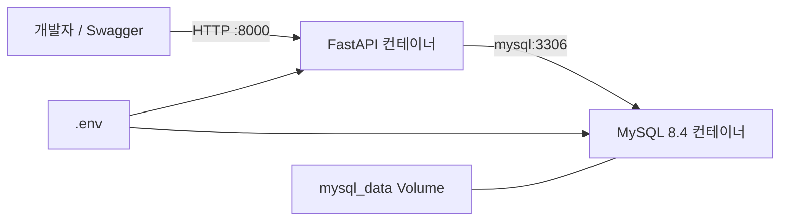
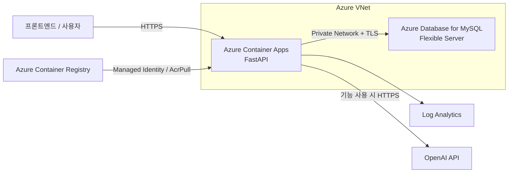
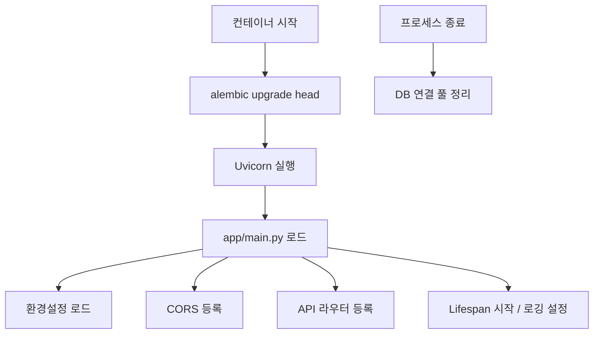
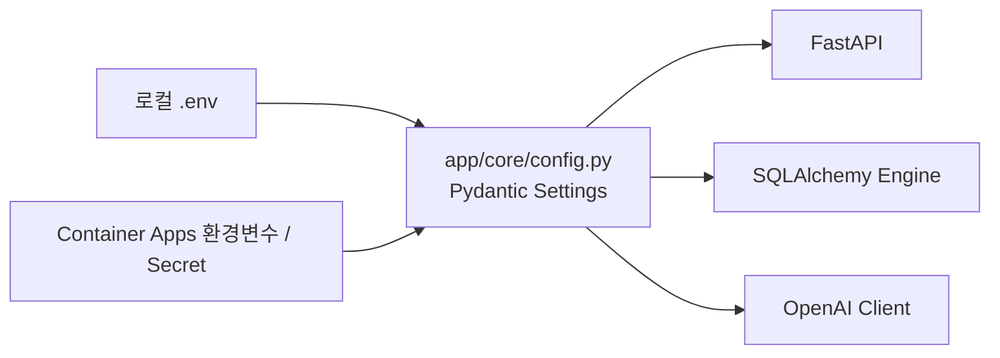
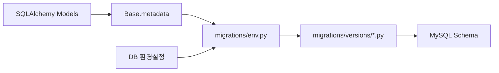
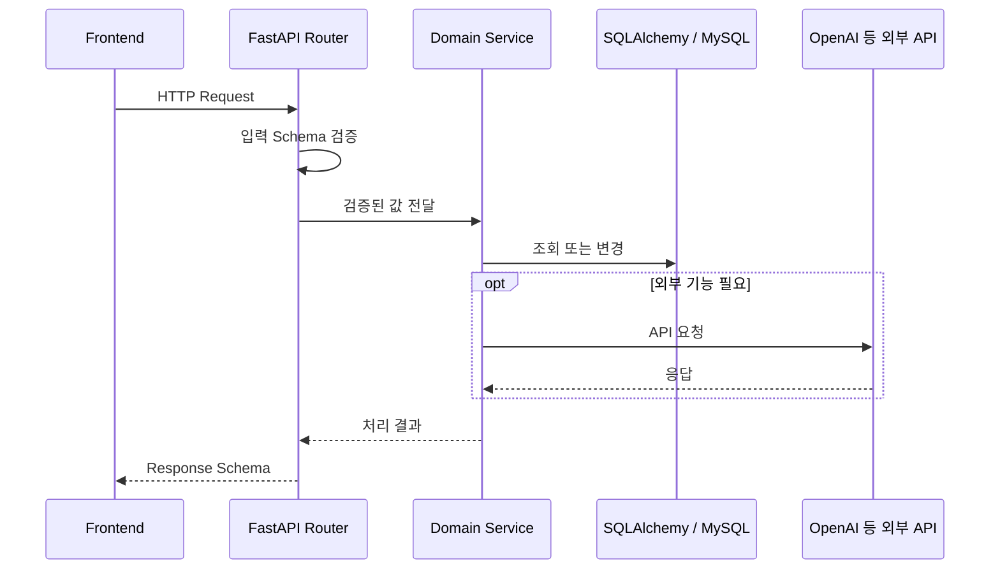
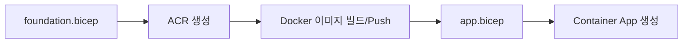
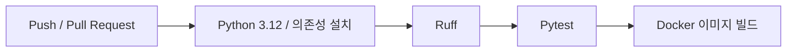

# 백엔드 시스템 아키텍처

이 문서는 현재 저장소에 구성된 FastAPI 백엔드의 구조와 로컬·Azure 실행 흐름을 설명합니다.
API 명세에 따른 도메인 기능과 DB 모델은 이후 작업에서 추가되며, 여기서는 현재 구현된 기반
구조를 기준으로 설명합니다.

## 1. 아키텍처 목표

현재 구조는 다음 목표로 설계했습니다.

- 로컬과 Azure에서 같은 Docker 이미지를 실행합니다.
- 설정과 비밀값을 코드에서 분리합니다.
- FastAPI, DB 연결, 비즈니스 로직의 책임을 분리합니다.
- 비동기 DB 처리를 사용해 요청 대기 중 다른 요청을 처리할 수 있게 합니다.
- DB를 인터넷에 직접 공개하지 않습니다.
- 공모전 초기 비용을 낮추면서 이후 확장할 수 있는 구조를 유지합니다.
- 인프라를 Bicep 코드로 재현할 수 있게 합니다.

## 2. 전체 실행 구조

### 로컬 개발 환경



Docker Compose가 API와 MySQL을 같은 내부 네트워크에 배치합니다. API는 `DB_HOST=mysql`을
사용해 MySQL 서비스에 연결합니다. MySQL 데이터는 Docker Volume에 보관됩니다.

### Azure 배포 환경



외부에서는 Container App의 HTTPS 주소에만 접근합니다. MySQL은 공개 네트워크 접근이
비활성화되어 있고 VNet 내부에서만 연결됩니다.

## 3. 디렉터리별 책임

```text
app/
├─ api/                 HTTP 라우터와 엔드포인트
│  ├─ routes/           도메인별 API 파일
│  └─ router.py         전체 API 라우터 조립
├─ core/                환경설정과 로깅 등 공통 기반
├─ db/                  SQLAlchemy Base, 엔진, 세션
├─ services/            비즈니스 로직과 외부 API 연결
└─ main.py              FastAPI 애플리케이션 조립 및 시작점

migrations/             Alembic DB 변경 이력
infra/                  Azure Bicep과 배포 스크립트
tests/                  자동 테스트
docs/                   개발 및 설계 문서
```

각 `__init__.py`는 폴더를 Python 패키지로 인식시키는 역할을 하며 비즈니스 로직은 포함하지
않습니다.

## 4. 애플리케이션 시작 흐름

Docker 컨테이너가 시작되면 다음 순서로 실행됩니다.



Dockerfile의 기본 실행 명령은 migration을 먼저 적용한 뒤 Uvicorn으로 FastAPI를 실행합니다.

```text
alembic upgrade head &&
uvicorn app.main:app --host 0.0.0.0 --port 8000
```

초기 개발 단계에서는 편의를 위해 컨테이너 시작 시 migration을 실행합니다. 여러 인스턴스를
운영하는 단계에서는 동시에 migration이 실행될 수 있으므로 별도 Azure Container Apps Job이나
배포 단계로 분리해야 합니다.

## 5. FastAPI 계층 구조

### `app/main.py`: 애플리케이션 조립

`main.py`는 다음 요소를 조립합니다.

- FastAPI 애플리케이션 객체
- CORS 미들웨어
- `/api/v1` API 라우터
- 시작·종료 Lifespan
- 기본 `/` 상태 응답

운영 환경에서는 Swagger와 ReDoc을 노출하지 않습니다.

### `app/api/router.py`: 라우터 조립

도메인별 라우터를 하나로 모읍니다. 현재는 상태 확인 라우터만 등록되어 있습니다.

```text
main.py의 /api/v1
  + router.py의 /health
    + health.py의 /live
    = /api/v1/health/live
```

새 도메인을 구현할 때 `main.py`에 직접 엔드포인트를 계속 추가하지 않고 다음 형태로
분리합니다.

```text
app/api/routes/users.py
app/api/routes/auth.py
app/api/routes/cubes.py
```

각 파일의 `APIRouter`를 `app/api/router.py`에 등록합니다.

### `app/api/routes/health.py`: 상태 확인

두 상태를 분리했습니다.

| 엔드포인트 | 확인 범위 | 사용 목적 |
|---|---|---|
| `/health/live` | FastAPI 프로세스 | 프로세스가 살아 있는지 확인 |
| `/health/ready` | FastAPI + MySQL | 실제 요청 처리 준비 여부 확인 |

Readiness는 MySQL에서 `SELECT 1`을 실행합니다. 연결에 실패하면 내부 오류나 DB 주소를
노출하지 않고 HTTP 503만 반환합니다. Azure Container Apps Probe도 이 주소들을 사용합니다.

## 6. 환경설정 구조

### 설정 출처



로컬과 Azure가 같은 환경변수 이름을 사용하므로 애플리케이션은 실행 위치를 기준으로 별도
코드를 작성할 필요가 없습니다.

### 일반 설정과 비밀값

일반 설정:

- `APP_NAME`
- `ENVIRONMENT`
- `LOG_LEVEL`
- `DB_HOST`, `DB_PORT`, `DB_NAME`, `DB_USER`
- `DB_SSL`
- `CORS_ORIGINS`
- `OPENAI_MODEL`

비밀값:

- `DB_PASSWORD`
- `MYSQL_ROOT_PASSWORD` — 로컬 Compose에서만 사용
- `OPENAI_API_KEY`

Pydantic이 문자열, Boolean, 정수, 배열 등의 타입을 검증합니다. DB 사용자와 비밀번호는 URL에
안전하게 포함되도록 인코딩한 뒤 SQLAlchemy 접속 URL을 생성합니다.

새 설정을 추가할 때는 다음 위치를 함께 확인해야 합니다.

1. `app/core/config.py`
2. `.env.example`
3. Azure에서도 필요하다면 `infra/app.bicep`

## 7. 데이터베이스 구조

### SQLAlchemy Base

`app/db/base.py`의 `Base`가 모든 ORM 모델의 공통 부모입니다. 모든 모델이 같은 Metadata에
등록되어야 Alembic이 테이블 변경을 감지할 수 있습니다.

향후 모델 구조 예시:

```text
app/models/
├─ user.py
├─ cube.py
├─ album.py
└─ conversation.py
```

### 비동기 Engine과 Session

`app/db/session.py`가 다음을 담당합니다.

- `mysql+asyncmy` 비동기 DB 연결
- 공용 SQLAlchemy Engine
- 요청 단위 `AsyncSession`
- 죽은 연결을 확인하는 `pool_pre_ping`
- 오래된 연결을 교체하는 `pool_recycle`
- Azure MySQL TLS 연결
- 애플리케이션 종료 시 연결 풀 해제

라우터나 서비스에서는 `get_db_session()`을 FastAPI Dependency로 받아 사용합니다.

```python
from fastapi import Depends
from sqlalchemy.ext.asyncio import AsyncSession

from app.db.session import get_db_session


async def example(
    session: AsyncSession = Depends(get_db_session),
):
    ...
```

### Alembic Migration

`alembic.ini`와 `migrations/env.py`가 현재 환경설정 및 SQLAlchemy Metadata를 Alembic에
연결합니다.



새 모델 모듈이 Alembic 실행 시 import되지 않으면 자동 생성에서 누락될 수 있습니다. 모델을
모은 `app/models/__init__.py`를 만들고 `migrations/env.py`가 이를 import하도록 구성해야 합니다.

현재 ERD 초안은 `docs/erd.md`에 있으며, ORM 모델과 실제 migration은 이후 DB 설계 작업에서
구현합니다.

## 8. 서비스와 외부 API

`app/services/`는 비즈니스 로직과 외부 서비스 연결을 배치하는 계층입니다. 현재
`openai_client.py`가 `AsyncOpenAI` 클라이언트 생성을 담당합니다.

OpenAI 클라이언트는 애플리케이션 시작 시 즉시 생성하지 않고 실제 기능에서 필요할 때
생성합니다. 따라서 `OPENAI_API_KEY`가 없어도 상태 확인이나 MySQL 기반 API는 실행할 수
있습니다.

실제 OpenAI 기능 구현 시 별도로 고려할 항목:

- 요청 타임아웃
- 일시 오류 재시도
- 응답 Schema 검증
- 프롬프트 버전 관리
- 토큰 사용량과 비용 기록
- 사용자 입력 안전성 검사
- API 키와 원문 대화 로그 노출 방지

라우터는 HTTP 입력·출력을 담당하고, 긴 비즈니스 로직과 OpenAI 호출은 서비스 계층에
배치합니다.

## 9. 권장 요청 처리 흐름

도메인 API가 구현된 이후 요청은 다음 방향으로 흐르도록 구성합니다.



계층별 책임:

| 계층 | 담당하는 것 | 피해야 하는 것 |
|---|---|---|
| Router | HTTP 상태, 요청·응답 Schema, 인증 Dependency | 긴 비즈니스 로직 |
| Service | 정책과 업무 흐름, 트랜잭션 단위 | FastAPI 응답 객체 직접 생성 |
| Model/DB | 테이블 구조와 DB 접근 | HTTP 요청 처리 |
| External Client | OpenAI 등 외부 통신 | 도메인 정책 전체 처리 |

프로젝트 규모가 커지면 복잡한 쿼리를 `repositories/`로 분리할 수 있지만, 초기부터 계층을 너무
많이 만들 필요는 없습니다.

## 10. Docker 아키텍처

### Dockerfile

API 이미지는 `python:3.12-slim`을 기반으로 합니다.

빌드 과정:

1. 최소 Python 이미지 사용
2. 필요한 시스템 빌드 패키지 설치
3. 애플리케이션과 migration 파일 복사
4. `pip install .`로 `pyproject.toml` 의존성 설치
5. 관리자 권한이 없는 `app` 사용자 생성
6. 8000 포트에서 Uvicorn 실행

`.dockerignore`가 `.env`, `.git`, `.venv`, 테스트 캐시 등을 이미지 빌드 Context에서
제외합니다. 특히 실제 `.env`가 이미지 안에 들어가지 않게 하는 보안 역할도 합니다.

### Docker Compose

`compose.yaml`은 로컬 전용 실행 구성입니다.

- `api`는 현재 Dockerfile을 빌드합니다.
- `mysql`은 MySQL 8.4 공식 이미지를 사용합니다.
- MySQL Healthcheck가 성공해야 API가 시작됩니다.
- MySQL 데이터는 Named Volume에 보존됩니다.
- 두 컨테이너는 Compose가 만든 내부 네트워크로 통신합니다.

Azure 배포에서는 Compose를 실행하지 않습니다. Dockerfile로 만든 API 이미지 하나를 ACR에
저장하고, DB는 Azure 관리형 MySQL을 사용합니다.

## 11. Azure 인프라 구조

Azure 리소스는 Bicep으로 관리합니다.

### `infra/foundation.bicep`

애플리케이션 이미지보다 먼저 필요한 기반 리소스를 생성합니다.

| 리소스 | 역할 | 주요 설정 |
|---|---|---|
| VNet | 프로젝트 전용 네트워크 | Container Apps/MySQL Subnet 분리 |
| Private DNS | MySQL 내부 주소 해석 | VNet 연결 |
| Log Analytics | 컨테이너 로그 수집 | 30일 보관 |
| Container Apps Environment | Container App 실행 환경 | 전용 Subnet 연결 |
| ACR | Docker 이미지 저장 | Basic, 관리자 계정 비활성화 |
| Managed Identity | Container App의 Azure 신원 | ACR 인증에 사용 |
| AcrPull Role | 이미지 읽기 권한 | 최소 권한 부여 |
| MySQL Flexible Server | 운영 DB | 비공개 접근, TLS, 20GB |

MySQL은 비용 절감을 위해 `Standard_B1ms`, 백업 7일, 고가용성 비활성화로 시작합니다.

### `infra/app.bicep`

ACR에 API 이미지가 생성된 이후 Container App을 배포합니다.

- 외부 HTTPS Ingress
- 내부 컨테이너 포트 8000
- ACR 이미지를 Managed Identity로 Pull
- DB 비밀번호와 OpenAI 키를 Container Apps Secret으로 저장
- 일반 설정은 환경변수로 주입
- Liveness/Readiness Probe 등록
- CPU 0.5, 메모리 1GiB
- 최소 0, 최대 2 Replica

최소 Replica가 0이므로 사용하지 않을 때 비용이 줄어들지만 첫 요청에는 콜드 스타트가 발생할
수 있습니다. 시연 전에 즉시 응답이 필요하면 `minReplicas`를 1로 변경할지 결정해야 합니다.

### Bicep을 두 단계로 나눈 이유



ACR이 있어야 이미지를 올릴 수 있고, 이미지가 있어야 Container App이 정상 실행됩니다. 이
순서를 만족하기 위해 기반 리소스와 앱 배포를 분리했습니다.

### `infra/deploy.ps1`

다음 세 단계를 자동 실행합니다.

1. `foundation.bicep` 배포
2. `az acr build`를 사용한 ACR 원격 이미지 빌드
3. `app.bicep`을 사용한 Container App 생성 또는 갱신

이미지 태그를 지정하지 않으면 Git commit SHA를 사용하고, 이를 구할 수 없으면 시간을
기반으로 태그를 생성합니다. `latest`만 사용하는 것보다 어떤 코드가 배포됐는지 추적하기
쉽습니다.

## 12. 네트워크와 보안

### DB 비공개 접근

운영 MySQL의 `publicNetworkAccess`는 비활성화했습니다. 인터넷에서 DB 3306 포트로 직접
접근할 수 없고, 같은 VNet에 연결된 Container Apps에서만 Private DNS를 통해 접근합니다.

### ACR 접근

ACR 관리자 계정은 비활성화했습니다. User Assigned Managed Identity에 `AcrPull` 역할만
부여해 Container App이 필요한 이미지만 읽습니다.

### 비밀값 관리

- 로컬: Git에서 제외된 `.env`
- Azure: Container Apps Secret과 Secret Reference
- 저장소: 값이 비어 있거나 `CHANGE_ME`인 `.env.example`만 커밋

현재 공모전 초기 구성에서는 Container Apps Secret을 사용합니다. 보안 요구가 커지면 Azure
Key Vault와 Managed Identity 연동을 검토합니다.

### CORS

로컬 기본 Origin은 프론트엔드 개발 서버를 고려한 다음 주소입니다.

- `http://localhost:3000`
- `http://localhost:5173`

운영에서는 실제 배포된 프론트엔드 도메인만 허용해야 합니다. `*`로 전체 Origin을 허용하지
않습니다.

## 13. 로깅과 관측

`app/core/logging.py`는 로그를 컨테이너 표준 출력으로 보냅니다.

- 로컬: `docker compose logs`
- Azure: Log Analytics

로그에 기록하지 않아야 하는 정보:

- Authorization Header와 Access Token
- DB 접속 URL과 비밀번호
- OpenAI API 키
- 불필요한 사용자 개인정보
- 원문 대화 전체

추후 요청 추적이 필요하면 Request ID, 구조화된 JSON 로그, 오류 추적 도구를 추가할 수
있습니다.

## 14. CI 구조

`.github/workflows/ci.yml`은 main Push와 Pull Request에서 다음을 실행합니다.



현재 CI는 Azure에 자동 배포하지 않습니다. Azure 권한과 GitHub OIDC 구성이 확정되기 전에
인프라가 자동 변경되는 것을 방지하기 위해 코드 검사와 이미지 빌드까지만 수행합니다.

브랜치 운영 시에는 `be/*` 작업 브랜치를 `dev`에 Pull Request로 합치고, 프론트/백 통합
테스트가 끝난 `dev`를 `main`으로 합치는 방식을 권장합니다.

## 15. 현재 설계 결정과 트레이드오프

| 결정 | 선택 이유 | 한계/후속 검토 |
|---|---|---|
| FastAPI + 비동기 SQLAlchemy | Python 생산성과 비동기 I/O | 세션·트랜잭션 규칙 필요 |
| Docker Compose 로컬 환경 | 팀원 간 동일한 실행 환경 | Docker Desktop 필요 |
| Azure Container Apps | VM/AKS 운영 부담 감소 | 콜드 스타트와 플랫폼 제약 |
| ACR + Managed Identity | 비밀번호 없는 이미지 Pull | 역할 전파 시간 고려 |
| 비공개 Azure MySQL | DB 인터넷 노출 방지 | 로컬 직접 접근이 어려움 |
| MySQL B1ms, HA 비활성화 | 공모전 초기 비용 절감 | 부하와 장애 대응 능력 제한 |
| 컨테이너 시작 시 Migration | 초기 배포 단순화 | 다중 Replica에서는 분리 필요 |
| `pyproject.toml` 의존성 | 설정 통합 | 완전 재현에는 Lock 파일 필요 |

## 16. 새 도메인 기능 추가 기준

예를 들어 사용자 API를 구현한다면 다음 순서로 확장합니다.

1. `app/models/user.py`: DB 모델
2. `app/schemas/user.py`: 요청·응답 Pydantic Schema
3. `app/services/user_service.py`: 비즈니스 규칙
4. `app/api/routes/users.py`: HTTP API
5. `app/api/router.py`: 라우터 등록
6. `migrations/versions/`: DB migration
7. `tests/`: 단위·통합 테스트

모델, Schema, Service, Router를 파일마다 별도 Git 브랜치로 나누는 것이 아니라 하나의 완성
가능한 도메인 기능을 같은 작업 브랜치에서 구현합니다.

## 17. 현재 구현 범위와 다음 단계

현재 완료:

- FastAPI 실행 구조
- 환경변수 기반 설정
- 비동기 MySQL 연결
- 상태 확인 API
- Alembic 기반
- OpenAI 클라이언트 생성 지점
- Dockerfile과 Docker Compose
- Azure Bicep과 배포 스크립트
- 기본 테스트와 CI

아직 구현되지 않음:

- `docs/erd.md`를 반영한 실제 SQLAlchemy 모델
- 최초 도메인 migration
- API 명세 기반 실제 엔드포인트
- 인증과 권한
- OpenAI 실제 서비스 로직
- MySQL을 사용하는 CI 통합 테스트
- 프론트엔드 연동 테스트
- 실제 Azure 최초 배포 검증

다음 개발 순서는 **ERD 확정 → SQLAlchemy 모델과 migration → 인증/핵심 도메인 API → OpenAI
연동 → 통합 테스트 → Azure 배포**를 권장합니다.
